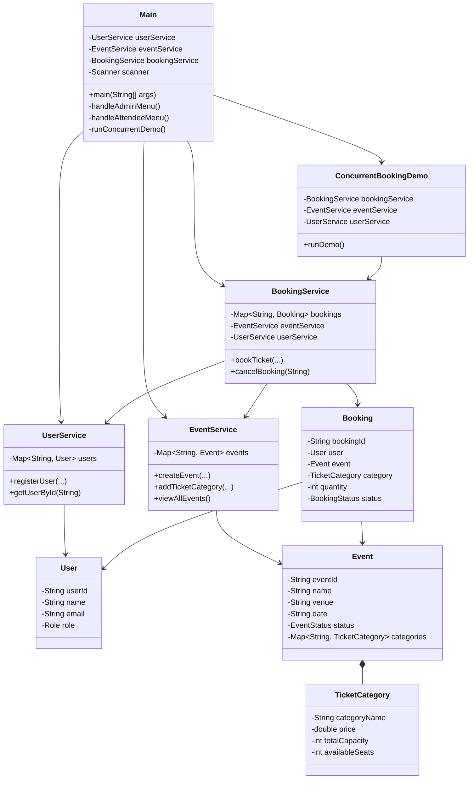

# Smart Event Ticket Management System

A console-based Java application designed to manage event creation, ticket categorization, user registration, and thread-safe ticket bookings using Object-Oriented Programming (OOP) principles, custom exception handling, and Java Multithreading.

---

## Project Setup & Execution Instructions

### Prerequisites
- **Java Development Kit (JDK):** Version 17 or higher.
- **IDE / Terminal:** IntelliJ IDEA, VS Code, or Command Prompt / PowerShell with `javac` and `java` configured.

### How to Run (Terminal)
1. Open the terminal in the project root directory (`smart-event-ticket-management`).
2. Compile all Java source files into an output directory (`out`):
   ```bash
   javac -d out src/enums/*.java src/exception/*.java src/models/*.java src/services/*.java src/demo/*.java src/Main.java
   ```
   *(Note: If any package folder name differs, compile using `javac -d out (Get-ChildItem -Recurse -Filter *.java src).FullName` in PowerShell).*
3. Run the application:
   ```bash
   java -cp out Main
   ```

### How to Run (IntelliJ IDEA)
1. Open the `smart-event-ticket-management` folder in IntelliJ IDEA.
2. Navigate to `src/Main.java`.
3. Click the green **Run (`▶`)** icon next to the `main` method (or press `Shift + F10`).

---

## Project Architecture & Class List

### 1. Models & Enums (`models/`, `enums/`)
- `Role`: Enum defining user roles (`ADMIN`, `ATTENDEE`).
- `EventStatus`: Enum tracking event lifecycle (`UPCOMING`, `ONGOING`, `COMPLETED`, `CANCELLED`).
- `BookingStatus`: Enum tracking reservation states (`CONFIRMED`, `CANCELLED`).
- `User`: Represents system users with ID, name, email, and role.
- `Event`: Represents an event with details (ID, name, venue, date, status) and its ticket categories.
- `TicketCategory`: Represents ticket tiers (e.g., VIP, General) with price, total capacity, and available seat count.
- `Booking`: Stores booking transactions linking a `User`, `Event`, `TicketCategory`, seat count, and `BookingStatus`.

### 2. Custom Exceptions (`exception/`)
- `EventNotFoundException`: Thrown when an operation references a non-existent Event ID.
- `UserNotFoundException`: Thrown when an unregistered or invalid User ID is accessed.
- `TicketsSoldOutException`: Thrown when requested ticket quantity exceeds available seats.
- `InvalidInputException`: Thrown when invalid data (negative price/capacity, empty fields, or invalid booking ID) is provided.

### 3. Core Services (`services/`)
- `UserService`: Manages user registration, retrieval, and validation.
- `EventService`: Handles event creation, adding ticket categories to events, and displaying available events.
- `BookingService`: Implements thread-safe ticket booking and cancellation using synchronization to prevent race conditions and overbooking.

### 4. Concurrency Demo (`demo/`)
- `ConcurrentBookingDemo`: Demonstrates multithreading by simulating multiple users concurrently attempting to book limited seats on the same event.

### 5. Console UI & Entry Point (Root Package)
- `Main`: Interactive `Scanner`-driven CLI menu integrating Admin/Organizer workflows, Attendee workflows, Concurrent Demo execution, and centralized `try-catch` exception handling.

---

## UML Class Diagram



---

## Data Storage & Future Scope Note
- **Current Storage:** All application data (users, events, ticket categories, and bookings) is currently stored in-memory using **Java Collections** (`HashMap`, `ArrayList`, `ConcurrentHashMap`). Data persists during runtime and resets when the application exits.
- **Planned Enhancement:** **CSV File Persistence** for saving and loading records across sessions is **Planned for CA-4**.

---

